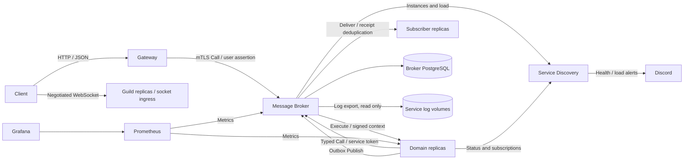

# Tamagotchi Go

Shared backend for virtual pet apps. Different frontend packages ship their own
creatures, art and care rules, backed by eight domain services, a Python Gateway,
Service Discovery and a custom Java message broker.


## Team

| Member | Services | Language |
|---|---|---|
| Patricia | User Management, Battle | C#, ASP.NET Core |
| Victoria | Tamagotchi, Notification | TypeScript, Node.js |
| Mihaela | Guild, Package Registry | TypeScript, Node.js |
| Sergiu | Map, Monster Raid | C#, ASP.NET Core |
| All four | Gateway, Service Discovery | Python, FastAPI |
| All four | Message Broker | Java 21, Spring Boot |


## Repository

Each service has its own private repository. They are linked here as submodules.

| Service | Submodule path | Owner |
|---|---|---|
| User Management | `services/user-management` | Patricia |
| Battle | `services/battle` | Patricia |
| Tamagotchi | `services/tamagotchi` | Victoria |
| Notification | `services/notifications` | Victoria |
| Guild | `services/guild` | Mihaela |
| Package Registry | `services/package-registry` | Mihaela |
| Map | `services/map` | Sergiu |
| Monster Raid | `services/monster-raid` | Sergiu |
| Gateway | `services/gateway` | Shared by the team |
| Service Discovery | `services/service-discovery` | Shared by the team |
| Message Broker | `services/message-broker` | Shared by the team |


## Service boundaries

Each service owns one part of the game and one database. Nothing reads another
service's tables.

| Service | Owns | Does not own |
|---|---|---|
| User Management | Accounts, login, JWT issuing, friends, enemies, global and local currency, which packages a user joined | Anything about creatures or battles |
| Tamagotchi | Creatures, origin owner, holder set, primary and secondary role, combat type, level, XP, raw package stats | Damage, battle outcome, what the stats mean |
| Battle | Challenges, turns, damage, who won, XP split, access grant decision | Creature state, currency balances |
| Guild | Guilds, members, roles, invitations, chat | User identity, raid state |
| Package Registry | Packages, stat definitions, bonus rules, starter config, assets, bosses, raid schedule | User data, live raids |
| Map | Latest locations, freshness, who is nearby | Friend lists, battles |
| Monster Raid | Live raids, boss HP, attacks, damage per player, rewards | Boss definitions, guild membership |
| Notification | Devices, push tokens, delivery, history, mute settings | Every domain decision, message text |
| Gateway | REST routing, caller validation, correlation and negotiation | Game rules, domain data, databases, events |
| Service Discovery | In-memory instance registry, health polling, transport/subscription metadata, failure removal and developer alerts | Domain data, authentication, application request routing |
| Message Broker | Durable admission/fan-out, delivery leases, gRPC routing, load balancing, instance breakers and administrative inspection | Domain effects, user account data or cross-service SQL |

Two rules keep the boundaries honest. Battle decides, Tamagotchi applies.
Package Registry holds configuration, the runtime services hold state.

A third rule follows from the shared-access model described below: a creature is
never moved, only shared. No service transfers ownership, and no service deletes
a creature as the result of a battle.

## Shared access

Winning a battle does not take the loser's creature away. It adds the winner to
that creature's **holder set**. There is still exactly one creature row, with one
level, one XP total and one set of package stats, and every holder sees the same
values. Nothing is split, because nothing is copied.

| Concept | Rule |
|---|---|
| `origin_owner_id` | The user the creature was minted for. Immutable, never changes for any reason |
| `holder_user_ids` | Everyone who may use, care for and select the creature. Contains the origin owner from the moment it is minted |
| Holder cap | **5.** A win against a creature that already has five holders grants global currency instead of access |
| Spread | Access is granted only to the winner of a battle the creature was staked in. It is never revoked, and holders cannot grant it to anyone else |
| Dropping access | A holder may remove themselves. The origin owner may not, so a creature always has at least one holder |
| Care | Any holder may run care actions. There is one hunger value and everyone shares the consequences |
| Primary selection | Per user, and it may point at any creature the user holds. The same creature may be the primary of several users at once |

The cap is what keeps a win meaningful. Without it every creature drifts toward
being held by everyone and the stake disappears; five is high enough that sharing
still spreads and low enough that a strong creature stays worth fighting for.

Shared care is deliberately unguarded. A co-holder can let a shared creature go
hungry, and that is part of the mechanic rather than an oversight.

**One battle at a time.** A creature is exclusive while it fights: it can be in
at most one battle or raid, and a second attempt to field it is refused with
`409 creature_engaged`. Because a creature can now have five holders, three rules
stop that lock from becoming a way to grief the others:

- The lock is taken at `accept`, not when the challenge is created, so an unanswered challenge never blocks anyone.
- A challenge expires after 2 minutes unaccepted, and an accepted battle auto-forfeits after its turn timer runs out, so a disconnected player cannot hold a shared creature forever.
- A user may hold at most one pending challenge per creature, so one holder cannot queue several and occupy it by rotation.

**No last-creature case.** Because a battle never removes a creature from anyone,
a collection cannot be emptied by losing. The only way to end up with nothing is
to drop access to everything, which the origin owner cannot do for their own
creature. The rejoin path and its 24 hour cooldown existed only to repair a
collection emptied by loss, and both are gone.

## Architecture

![Architecture: clients reach the Gateway over REST, and the Gateway sends every public operation to the custom Message Broker over mTLS gRPC; the broker queues, balances and delivers calls to the two replicas of each service, carries typed service-to-service calls and outbox events through topics and subscriber queues, and keeps its work in its own PostgreSQL database; Service Discovery gives the broker instances, load and subscriptions and sends alerts to Discord; Prometheus, Grafana and Jaeger collect metrics and traces; Guild chat sockets and the JWKS bootstrap stay direct](docs/img/architecture_diagram.png)

Every public API request goes Client → Gateway → Message Broker → service, and
services call each other and publish events only through the Broker. There is no
RabbitMQ and no service-to-service HTTP. `deploy/compose.yaml` defines this stack with numeric image pins; see
[Deployment](#deployment) for publication and startup requirements.



Each domain service owns its database, effects and authorization. Synchronous
service dependencies become typed gRPC calls through Broker; committed facts
use durable topic subscriptions. Destination queues support public Gateway calls,
logical subscriber queues distribute work across replicas, and transient
per-instance subscriptions support Guild relay. Consumers retain event receipts.

Broker selects fresh eligible instances using reported load plus assignments
since the last sample, reserves one half-open trial and handles safe-only
failover. Discovery supplies addresses, process IDs, load and approved subscription
metadata; it does not forward application requests. Breakers and delivery outcomes
belong to Broker on migrated paths, rather than a second Gateway routing layer.

Direct probes, Discovery, metrics, issuer JWKS bootstrap, external providers and
negotiated Guild sockets remain infrastructure paths. Narrowly allowlisted Map
demo assets keep Discovery-aware HTTP forwarding inside the `/map/demo/` prefix;
they are not an application API fallback. Guild replica relay does not replay
messages missed during a Broker gap: clients recover them from stored history.

### Service Discovery

Service Discovery is an internal control-plane service. Its registry and failure
windows are in memory; it has no database or broker queues. It exposes registration,
instance listing and failure-report APIs, polls registered status endpoints and
removes failing instances. Developer alerts use an optional Discord webhook.
The implementation and API are documented in [its README](https://github.com/PatriciaMoraru/service-discovery#readme).

Compose pins `patriciamoraru/service-discovery:4.0.0`. The Broker reads instances
and load from it and reports failed calls to it; Discovery removes instances that
fail their status checks or reach the failure threshold. Its API answers a full
task pool with 503 `too_many_tasks` and `Retry-After`, and a slow task with 504
`task_timeout`. The registry is in memory: after a Discovery restart, lookups are
empty until every service registers again, which takes up to about 30 seconds.

Inside Compose, use `http://service-discovery:3009`. Local diagnostics use
`http://localhost:3009`; the published port is loopback-only. No Gateway prefix or
Gateway assertion is used for this internal API. Configure `DISCORD_WEBHOOK_URL`
privately and `ALERT_COOLDOWN_SECONDS` (default 300) in `deploy/.env`. Leave the
webhook blank for logging-only operation. Direct registration/status traffic is
an infrastructure exception to application REST routing through Gateway.

### Gateway

Gateway is the public HTTP entry point. It verifies bearer credentials, enforces
root admission/deadlines and rate limits, matches public routes against a pinned
operation manifest, signs destination-bound user context and reconstructs the
public HTTP response. It owns no domain database or event stream.

Public operations always use mTLS `MessageBroker.Call`, and the Broker chooses the
replica. Internal-only operations have no public mapping; domain services call
each other through the Broker with typed messages. Services verify the Broker
context and do their own business authorization. Common failures are 502
`upstream_unavailable`, 503 `too_many_tasks` with `Retry-After` for capacity and
504 `task_timeout` when the root deadline expires; domain Problem Details pass
through unchanged. The whole Protobuf envelope is bounded to 1 MiB, with stricter
per-operation limits. Gateway readiness includes its Broker connection. The only
direct forwarding left is the Map demo's static assets.

For `guild.chat`, Gateway invokes the internal-only volatile
`guild.issue_chat_ticket` operation as authenticated workload gateway with a
user assertion. Guild verifies membership and returns the single-use 30-second
ticket. The browser connects to the negotiated public WebSocket ingress; Gateway
does not hold the socket. Transient relay gaps require history catch-up.

Gateway logs completed requests with correlation, operation, route, status and duration;
metrics remain on its internal monitoring port. Its source, published image and
validated deployment are separate evidence. See
[the Gateway README](https://github.com/victoriaaa111/gateway#readme).

Failure reports and status polling remain direct internal APIs; see
[Service Discovery, direct](#service-discovery-direct) and
[docs/field-types.md](docs/field-types.md). Registry state is in memory and
replicas re-register after Discovery restart.

### Broker contracts

[contracts/README.md](contracts/README.md) defines the operation catalogue,
Protobuf transport and identity rules. Consumers pin immutable Shared commits and
per-file checksums; generated code is build output.

The Broker's management port 3010 serves health, readiness and status, and for
admins the active topics, dead letters and the bounded ZIP log export of every
service (`GET /v1/logs/download?from=&to=&correlation_id=`). Its internal gRPC
listener is 5010 and its metrics port 9090. [Structured log volumes](deploy/log-volumes.md)
and [Monitoring](deploy/monitoring.md) describe the log and metrics setup.

## Technologies

| Service | Stack | Database | Why |
|---|---|---|---|
| User Management | C#, ASP.NET Core | PostgreSQL | Money and identity need strict typing and real transactions |
| Battle | C#, ASP.NET Core | PostgreSQL | Turn state and settlement retries, same reason |
| Tamagotchi | TypeScript, Node.js, Express, Zod | PostgreSQL | Mostly reads and writes rows; JSONB stores package stats with no fixed shape |
| Notification | TypeScript, Node.js, Express, Firebase Admin | PostgreSQL | Waits on the network, never computes |
| Guild | TypeScript, Node.js, Express, WebSocket | PostgreSQL | Chat needs many open connections |
| Package Registry | TypeScript, Node.js, Express| PostgreSQL | Config documents differ per package |
| Map | C#, ASP.NET Core, EF Core | PostgreSQL with PostGIS | Distance queries need a spatial index |
| Monster Raid | C#, ASP.NET Core, EF Core | PostgreSQL | Counters under concurrent attacks |
| Gateway | Python 3.13, FastAPI, Uvicorn, HTTPX, uv | None | Public authentication/mapping and bounded broker dispatch |
| Message Broker | Java 21, Spring Boot, gRPC, JDBC | Dedicated PostgreSQL | Durable queues, routing, workers and administrative inspection |

The domain services use TypeScript and C#. Gateway uses Python with uv 0.12.23
and a checked dependency lock. It has no database or event publisher.

Trade-offs we accepted:

- Node is slower at CPU work. None of these four services do CPU work.
- C# is more code for a small CRUD endpoint. It pays off where a wrong number is a bug a player can see.
- One PostgreSQL engine everywhere, so one thing to learn and one Compose service. PostGIS is an extension, not a second database.

## Communication patterns

How services talk:

| Interaction | Shape | Technology | Where |
|---|---|---|---|
| Public request and response | One to one, synchronous | HTTP/JSON then mTLS gRPC Call/Execute | Client → Gateway → Broker → destination |
| Internal request and response | Typed synchronous call | mTLS gRPC Call/Execute | Service → Broker → destination |
| Publish and subscribe | One to many, asynchronous | Broker Publish/Deliver and durable logical queues | Committed domain facts |
| Bidirectional stream | One to one, asynchronous, both sides send | WebSocket | Guild chat |
| One way notification | One to one, asynchronous, through a third party | Firebase Cloud Messaging | Push to a phone that is not running the app |

A battle cannot start without the participants, so that call is synchronous. A
granted access is a fact, not a request, so it is an event and the publisher does
not need to know who reacts.

Named patterns we use:

| Pattern | Where |
|---|---|
| API Gateway | One entry point, routes by service prefix, verifies callers, signs their identity and carries correlation IDs; see [Gateway](#gateway) |
| Database per Service | Eight databases, separate credentials |
| Transactional Outbox | Every publisher, so a state change and its event commit together |
| Idempotent Consumer | Every consumer, dedupe on `event_id` |
| Dead Letter Channel | Three attempts (at once, after 5 s, after 30 s), then a dead letter that admins list at the Broker |
| Competing Consumers | Replicas of one service share its logical subscription |
| Correlation Identifier | One ID follows a request through the Gateway, the Broker, every service, their events and the push |
| Optimistic Offline Lock | `ETag` and `If-Match` on edits |


## Data management

One database per service. Separate credentials, so a service cannot read another
service's tables even by accident. In development all eight run as separate
schemas in one PostgreSQL container, each with its own user and grants.

What it costs, and what we do instead:

| Cost | Answer |
|---|---|
| No joins across services | Two calls and a join in the caller |
| No foreign keys across services | Events clean up, for example a deleted user |
| No distributed transactions | Outbox at the publisher, dedupe at the consumer |

Consistency is ACID inside a service and eventual between services. Three
mechanisms carry it:

- **Outbox.** A state change and its event commit in one transaction. A poller publishes the row after commit, so nothing is announced for work that rolled back.
- **Idempotency-Key.** Required on every command that is not naturally repeatable. A retry after a timeout does not double an award.
- **Consumer dedupe.** Every consumer stores `event_id` under a unique constraint, so at-least-once delivery becomes one effect.

## Communication contract

The endpoint tables and specifications below define the integration target.
They do not establish runtime completion: each owner must validate their source
and deployed image against this contract. Record incompatible behavior before
changing a shared definition.

### Conventions

| Concern | Rule |
|---|---|
| Gateway routing | `/{service}/v1/...`, the prefix is stripped before the service sees it |
| Payload | JSON, UTF-8, snake_case |
| IDs | UUID v7, string encoded |
| Timestamps | ISO 8601, UTC, milliseconds |
| Errors | RFC 9457, `application/problem+json`; `type` is `about:blank` or an absolute problem-type URI, `code` identifies the application error |
| Pagination | Opaque cursor, never an offset |
| Concurrency | `ETag` on reads, `If-Match` on writes, 412 on mismatch |
| Idempotency | `Idempotency-Key` header on non-repeatable commands |
| Auth, user | JWT from User Management, verified against a cached JWKS |
| Auth, service | Internal JWT with a `scope` claim, never given to clients |
| Correlation | `X-Correlation-Id` from the gateway, passed on and copied into events |

The tables below name the request and response shape of every endpoint. Each
shape is listed field by field, with types and which fields are required, in
[field-types.md](docs/field-types.md).

Every service also exposes `GET /health` and `GET /ready`, returning 200 or 503.

<a id="status-endpoint"></a>

### Status endpoint

Every service, Gateway and Service Discovery included, also exposes `GET /status`
for Service Discovery. Service Discovery calls it directly on the instance's
registered address, not through Gateway.

| Method and path | Request | Response | Access |
|---|---|---|---|
| `GET /status` | none | 200 Status, or 503 Status when `DOWN` | direct, Service Discovery |

`status` is `UP` when the instance works, `DEGRADED` when it works with a problem it
reports itself, and `DOWN` when it cannot serve requests. Every `load` field is
optional: a rule whose field is missing is skipped, so a minimal answer still works.

Service Discovery calls every registered instance every 5 seconds with a 2 second
timeout. A timeout, connection error, non-200 response, `DOWN` or a body without a known `status`
marks the instance unhealthy: it stops being routable and the failure is reported to
failure tracking. A healthy answer that reaches a critical load limit raises a
`load_critical` alert for each broken rule.

| Rule | Value | Default limit |
|---|---|---|
| `in_flight_requests` | `load.in_flight_requests` | 20 |
| `requests_last_minute` | `load.requests_last_minute` | 600 |
| `avg_response_ms_last_minute` | `load.avg_response_ms_last_minute` | 2500 |
| `status_call_ms` | duration of the `/status` call | 1500 |
| `status` | `DEGRADED` | none |

The limits are Service Discovery settings, listed in its README.

<a id="gateway-routing-and-negotiation-proposal"></a>

### Gateway routing and negotiation

Browser/local clients use `http://localhost:3000`; containers use
`http://gateway:3000`. These are local deployment addresses, not production URLs.

| Prefix | Service | Broker destination |
|---|---|---|
| `/users` | User Management | `user-management` |
| `/tamagotchi` | Tamagotchi | `tamagotchi` |
| `/battle` | Battle | `battle` |
| `/guild` | Guild | `guild` |
| `/registry` | Package Registry | `package-registry` |
| `/map` | Map | `map` |
| `/raid` | Monster Raid | `monster-raid` |
| `/notification` | Notification | `notification` |

The Gateway matches each request against the public operations of the catalogue
and sends it through the Broker; it never forwards to a service address. Method,
path parameters, query, body, status and end-to-end headers (replay, conditional
request, correlation) are preserved; the caller's Authorization is replaced by a
signed assertion. For example, `GET /map/v1/location/{userId}` becomes the Map
operation for that route. Routes outside the catalogue return `404 unknown_route`;
a Broker that cannot be reached returns `502 upstream_unavailable`. Domain error
responses pass through unchanged.

Direct health/readiness probes, Gateway's configured bootstrap JWKS lookup,
database/broker connections, provider assets and negotiated Guild sockets are
explicit exceptions. Gateway is not an arbitrary external proxy.

| Method and path | Request | Response | Access |
|---|---|---|---|
| `ANY /{service}/v1/...` | downstream request | downstream response | per endpoint |
| `POST /gateway/v1/ws-negotiate` | WsNegotiateInput | 200 WsTicket | user |
| `GET /health` | none | 200 Health | public |
| `GET /ready` | none | 200 Readiness or 503 Problem | public |

Gateway also serves Prometheus metrics at `GET /metrics` on a separate monitoring
port, `METRICS_PORT` (default 9090), from the first image after `2.0.2`. It is not part
of the public route table above: it carries request counts, latencies and work-pool
usage, no domain data, and needs no assertion. Deployments publish it only to the
monitoring network, never to clients. Prometheus scrapes it in the monitoring
overlay. The Gateway README lists the metric names.

Only `guild.chat` is supported. The Gateway asks Guild for a ticket through the
Broker (`guild.issue_chat_ticket`). Guild issues and validates a single-use 30-second ticket.
The browser connects directly to Guild, using a configured browser-reachable
URL, not container DNS. Gateway does not hold the socket open.

| Status | Negotiation code | Condition |
|---|---|---|
| 400 | `invalid_ws_resource` | resource is not guild.chat |
| 400 | `invalid_resource_id` | resource_id is not UUIDv7 |
| 401 | `unauthenticated` | missing or invalid caller token |
| 403 | `guild_membership_required` | caller is not an eligible guild member |
| 404 | `guild_not_found` | guild does not exist |


<a id="verified-identity-proposal"></a>

### Verified identity

The Gateway implements this behaviour. User Management must issue the tokens and
services must verify the assertion before the identity is relied on.

Gateway verifies each bearer token in Authorization, then removes the header before
dispatch. It removes `X-User-Id`, `X-User-Roles`, `X-Service-Name` and any client copy
of `X-Gateway-Assertion`, then sends its own `X-Gateway-Assertion`.
Downstream services use the verified claims in `X-Gateway-Assertion` for identity;
plain headers alone grant no access. Existing endpoint Access columns remain
authoritative. Anonymous assertions carry no user or service permissions.

| Token | Issuer | Audience | Subject | Lifetime |
|---|---|---|---|---|
| User access | tamagotchi-go-users | tamagotchi-go | UUIDv7 user id | 900 seconds |
| Service access | tamagotchi-go-users | canonical destination service | service:name | 300 seconds |
| Gateway assertion | tamagotchi-go-gateway | canonical destination service | verified caller or anonymous | at most 30 seconds |

Access tokens use `typ=at+jwt`; assertions use `typ=gateway-assertion+jwt`.

Roles come from User Management. It reads them from its table when it issues a
user access token at login, as a `roles` claim: an array of 0 to 20 strings of 1 to
64 characters, `[]` for an ordinary user. Gateway checks that shape and copies the
verified roles into the assertion. Service access tokens carry `scope` only and no
roles, so service assertions have empty roles. `admin` is the only role in use.
Allow only RS256 with RSA keys of at least 2048 bits. Verify signature, type,
issuer, audience, subject, issuance and expiry; never choose algorithms or key
URLs from untrusted claims. Allow five seconds of token clock tolerance, but
none for request deadlines. See [JWT validation guidance](https://www.rfc-editor.org/rfc/rfc8725.html).
JWT time claims use NumericDate seconds; the signed request deadline uses Unix
milliseconds. Application timestamps remain ISO 8601 UTC with milliseconds.

Gateway alone holds its assertion private key. Services load the public JWKS
from a mounted file. Use `GATEWAY_ASSERTION_PRIVATE_KEY_PATH`,
`GATEWAY_ASSERTION_KEY_ID` and `GATEWAY_ASSERTION_JWKS_PATH` for configuration;
services and Gateway load the public set. Gateway uses it to verify nested
service context and to check key readiness.
Paths and key ids are configuration, never private key values in documentation.
Deploy a new public key first, switch Gateway's signing kid, then remove the old
key after its assertions and five-second tolerance expire. Keep access-token
and assertion key sets separate.

Gateway fetches User Management keys asynchronously from the configured direct
`GET /v1/jwks` bootstrap URL, with a 300-second cache. An unknown kid triggers
one refresh shared by concurrent requests. Valid cached keys remain usable
within the cache lifetime; never accept unknown keys or an expired cache because
refresh failed. Invalid tokens return `401 unauthenticated`. Refresh failure
without a usable key returns `503 auth_keys_unavailable`.

**Service tokens.** A service that calls another service asks User Management for a
token with `POST /v1/service-tokens`, body `{service_name, audience, scopes}`. The token
has `sub=service:<service_name>`, `aud` the one destination service, a `scope` claim
that is a single space-separated string, and lasts 300 seconds. It carries no roles.
Clients keep one token per destination and scope set, and renew it about 30 seconds
before it expires.

A service has no token before its first one, so this call needs only its workload
certificate and its secret. The caller proves who it is in one of two ways, and a wrong
credential never falls back to the other:

- A service calls `users.issue_service_token` through the Broker with its own client
  secret as `x-service-secret` call metadata, never as a bearer token. Each service that
  calls another service holds its own secret as `SERVICE_CLIENT_SECRET` and never sends it
  anywhere else. User Management verifies it against the secret configured for
  `service_name`. Registry and Notification call no other service and have none.
- An admin user calls the public route `POST /users/v1/service-tokens`, with no secret.

The issuer checks a configured allowlist of destinations and scopes for that service.
Requesting a scope does not grant it: if any scope asked for is not on the allowlist,
nothing is issued. The caller is authenticated before the allowlist is consulted. Gateway
checks the service token audience against the routed destination; downstream services
enforce the required permissions from the signed assertion.

| Status | Code | Condition |
|---|---|---|
| 400 | `validation_error` | unknown `service_name` or `audience`, more than 20 scopes, or a scope that is empty, over 64 characters or contains whitespace |
| 401 | `invalid_client` | wrong, missing or repeated secret, or a service with no secret. One answer for all of them, so none can be told apart from outside |
| 403 | `admin_required` | no secret, and the caller is a user who is not an admin or is another service |
| 403 | `audience_not_allowed` | the service may not call that destination |
| 403 | `scope_not_allowed` | at least one scope asked for is not allowed, and the detail names only those |
| 503 | `signing_key_unavailable` | User Management has no usable signing key |

A scope is `<prefix>:<action>` in lower case, where the prefix is the Gateway prefix of the
service being called: `users`, `tamagotchi`, `battle`, `guild`, `registry`, `map`, `raid`
or `notification`. Each owner names the scopes on their own service. User Management's are:

| Scope | Route |
|---|---|
| `users:read-profile` | `GET /v1/users/{userId}`, user or service |
| `users:read-relationships` | `GET /v1/users/{userId}/relationships`, user or service |
| `users:check-relationship` | `GET /v1/users/{userId}/relationship/{otherId}` |
| `users:read-wallet` | `GET /v1/users/{userId}/currency/global`, user or service |
| `users:credit-global` | `POST /v1/users/{userId}/currency/global/add` |
| `users:credit-local` | `POST /v1/users/{userId}/currency/local/add` |
| `users:settle-battle` | `POST /v1/internal/battle-settlements` |
| `users:consume-boost` | `POST /v1/internal/boost-consumptions` |
| `users:read-membership` | `GET /v1/internal/users/{userId}/membership` |

Battle is the caller of `users:read-profile` (opponent check and `challenger_username`),
`users:settle-battle` and `users:consume-boost`, and also of `users:credit-global` for the
`BATTLE_ACCESS_CAP` credit it pays when a holder grant returns `CAP_REACHED`. Monster Raid is
the other caller of `users:credit-global`.

Tamagotchi's are:

| Scope | Route | Caller |
|---|---|---|
| `tamagotchi:read-creature` | `GET /v1/tamagotchis/{id}`, user or service | |
| `tamagotchi:award-xp` | `POST /v1/tamagotchis/{id}/xp` | Battle and Monster Raid, at settlement |
| `tamagotchi:grant-access` | `POST /v1/tamagotchis/{id}/holders` | Battle, at settlement |
| `tamagotchi:read-holders` | `GET /v1/tamagotchis/{id}/holders`, user or service | Battle, to check who may field a creature |
| `tamagotchi:read-collection` | `GET /v1/users/{userId}/collection`, user or service | Monster Raid |
| `tamagotchi:reserve-engagement` | `POST /v1/internal/engagements` | Battle, Monster Raid |
| `tamagotchi:read-engagement` | `GET /v1/internal/engagements/{referenceId}` | Battle, Monster Raid |
| `tamagotchi:release-engagement` | `POST /v1/internal/engagements/{referenceId}/release` | Battle, Monster Raid |
| `tamagotchi:mint` | `POST /v1/tamagotchis` | none yet |

`tamagotchi:mint` is named for completeness. A creature is minted from
`user.package_joined.v1`, which Tamagotchi consumes itself, so no service calls
that route today and nothing should be allowlisted for it until one does.

Notification has no scopes. All eight of its routes are user access, it publishes
nothing and no service calls it, which is also why it holds no
`SERVICE_CLIENT_SECRET`.

Guild's is:

| Scope | Route | Caller |
|---|---|---|
| `guild:read` | `GET /v1/guilds/{guildId}` and `GET /v1/guilds/{guildId}/members`, both user or service | Monster Raid |

Monster Raid reads both through the Broker as typed calls (`guild.get_guild`,
`guild.list_members`) for leader and membership checks. Its `guild:read` grant belongs to caller `monster-raid`.

Registry's are:

| Scope | Route | Caller |
|---|---|---|
| `registry:read-config` | `GET /v1/packages/{packageId}/stat-definitions`, `stat-bonuses`, `currency-rules` and `starter-pet` | Tamagotchi for package configuration; User Management for currency rules; Monster Raid and Battle for stat bonuses and stat definitions |
| `registry:check-eligibility` | `POST /v1/packages/eligibility-check` | Guild |
| `registry:read-bosses` | `GET /v1/bosses/{bossId}`, user or service | Monster Raid |
| `registry:read-occurrences` | `GET /v1/raid-occurrences/{id}`, user or service | Monster Raid |
| `registry:read-members` | `GET /v1/packages/{packageId}/users` | none yet |

`registry:read-members` is named for completeness; no service calls it today,
so nothing should be allowlisted for it until one does.

Registry calls no other service, so it holds no `SERVICE_CLIENT_SECRET` either.

These are all current issuer grants, the User Management allowlist
`service-token-policy.json` (user-management `7463266`). Each row is a caller service, a single
destination audience and its permitted scope set:

| `service_name` | `audience` | Scopes |
|---|---|---|
| `battle` | `package-registry` | `registry:read-config` |
| `battle` | `tamagotchi` | `tamagotchi:award-xp`, `tamagotchi:grant-access`, `tamagotchi:read-holders`, `tamagotchi:reserve-engagement`, `tamagotchi:read-engagement`, `tamagotchi:release-engagement` |
| `battle` | `user-management` | `users:read-profile`, `users:settle-battle`, `users:consume-boost`, `users:credit-global` |
| `guild` | `package-registry` | `registry:check-eligibility` |
| `guild` | `user-management` | `users:check-relationship`, `users:read-membership` |
| `map` | `user-management` | `users:read-relationships` |
| `monster-raid` | `guild` | `guild:read` |
| `monster-raid` | `package-registry` | `registry:read-config`, `registry:read-bosses`, `registry:read-occurrences` |
| `monster-raid` | `tamagotchi` | `tamagotchi:read-collection`, `tamagotchi:reserve-engagement`, `tamagotchi:read-engagement`, `tamagotchi:release-engagement`, `tamagotchi:award-xp` |
| `monster-raid` | `user-management` | `users:credit-global` |
| `tamagotchi` | `package-registry` | `registry:read-config` |
| `tamagotchi` | `user-management` | `users:credit-local` |
| `user-management` | `package-registry` | `registry:read-config` |

Notification and Package Registry hold no grants. User Management signs its own Registry
token in process with `registry:read-config`, the scope of its row; it does not request one.

Raid and Battle request one operation scope per token; the table describes the allowed
set, not a combined token for all destinations. The older proposal names
`tamagotchi:engage` and `tamagotchi:grant-xp` are superseded. `raid:read` protects
service reads of a raid and its leaderboard, but has no current service caller;
do not add a speculative issuer grant. The table documents the policy; it does not
issue or widen a grant, and a change to a grant is made in the policy first.

A user needs no scope on the routes marked user or service. A service without the scope
gets `403 insufficient_scope`. Which service may have which scope is the User Management
allowlist, `service-token-policy.json`, and each owner adds their own lines to it by pull request.

Public routes are exactly those marked public in the endpoint tables, plus
Gateway health/readiness. If Authorization is supplied even on a public route,
validate it; an invalid token does not become an anonymous request. The direct
User Management JWKS bootstrap and service health, readiness and status probes are explicit
exceptions to downstream assertion enforcement. Other direct domain calls must
fail without a valid Gateway assertion.

| Downstream status | Code | Condition |
|---|---|---|
| 401 | `invalid_gateway_assertion` | missing, repeated, forged, expired, wrong-type or wrong-audience assertion, or invalid claims |
| 401 | `unauthorized` | valid assertion, but anonymous on a route that needs a caller |
| 403 | `insufficient_scope` | valid assertion lacks required permissions, including the wrong kind of caller (a service on a user route, a user on a service route) |
| 403 | `not_self` | a user asked for another user's resource on a route limited to its owner |
| 503 | `gateway_keys_unavailable` | the service cannot read the Gateway's public keys, so it cannot verify any assertion |

Every route except `GET /health`, `GET /ready`, `GET /status` and the User Management `GET /v1/jwks`
needs an assertion, public routes included, which carry an anonymous one.

Gateway removes `X-User-Id`, `X-User-Roles` and `X-Service-Name` from every request.
Services take identity only from the verified assertion.
Never log bearer tokens, assertions, key material or refresh credentials.

<a id="work-limits-proposal"></a>

### Work limits

The Gateway, the Broker, Discovery, Map and Monster Raid enforce admission,
deadlines and cancellation; each owner service documents its own limits. The
values below are defaults, not measured throughput.

| Component | Local timeout | Per-process admission |
|---|---|---|
| Gateway | 5000 ms | 64 client/public requests and 64 authenticated service requests |
| Each domain service | 3000 ms | 64 tasks shared by domain requests, message processing and worker batches |

Only a verified service access token enters Gateway's service pool. A caller
cannot select it with headers. There is no admission waiting queue: a full pool
returns `503 too_many_tasks` with `Retry-After: 1`. An expired deadline returns
`504 task_timeout`. Even the reserved service pool may saturate; calls fail promptly rather than
waiting while holding another slot. Gateway performs
no automatic retries of HTTP mutations.

A new Gateway root gets deadline `now + 5000 ms`, carried in the assertion as
`deadline_unix_ms`. Each service's effective deadline is the earlier of the root
deadline and `now + 3000 ms`. Convert the remaining budget to a local monotonic
timer; never restart a full timeout for each dependency or attempt.

Request aborts, deadlines and shutdown cancel HTTP/SQL operations. Roll back
uncommitted work and retain any committed receipt/effect progress. Release a
slot only when its actual work and cleanup finish, not merely when the client
has received a timeout. No detached work may escape the capacity accounting.

Health, readiness and status probes use a separate bounded three-second check and
no domain slot. Startup initialization remains governed by shutdown cancellation.
Established Guild sockets do not occupy Gateway HTTP slots; negotiation and
message handling are bounded tasks. Guild owns its separate socket lifetime and
connection policy. A worker batch uses a service slot and local deadline; leave
durable work pending and retry on its normal schedule if no slot is available.

Required evidence: rejection under saturation, inherited deadline budgets,
deadline/abort/shutdown cancellation, rollback, worker recovery and slot reuse.
HTTP failure does not prove that an external side effect did not commit; command
replay and durable reward effects handle uncertain outcomes.

<a id="command-replay-and-pagination-proposal"></a>

### Command replay and pagination

Map and Monster Raid implement command replay and cursors as below; successful
response shapes are unchanged.

Replay covers `POST /map/v1/location`, `POST /raid/v1/raids` and
`POST /raid/v1/raids/{raidId}/attack`, the nine User Management commands
named under its implementation notes, and the five Battle commands (create,
accept, reject, attack and forfeit) named under its implementation notes. Require an Idempotency-Key of 1 to 128
printable ASCII characters after HTTP header whitespace normalization; absence
or invalid values return `400 invalid_idempotency_key`. Keys are case-sensitive.
Scope is the verified caller, HTTP operation and resource path. Fingerprint the
validated request model with deterministic field order, normalized UUIDs and
UTC timestamps; JSON property order alone must not create a conflict.

Retain completed receipts for 24 hours from completion. Identical retries return
the stored status/body and applicable response headers, with the current request's
correlation header. Do not replay transport, authentication or correlation
headers from the old request. Changed input returns `409 idempotency_conflict`;
concurrent pending work returns `409 command_in_progress`.
Authenticate/authorize before lookup, including every replay. Malformed input
and authentication failures do not reserve a key. Persist successful and final
domain-error receipts with their local state transition. Do not freeze transient
dependency, capacity or timeout errors as completed receipts. Durable pending
work must recover uncertain external effects before completing the receipt.
Persist local effects and receipts atomically; reward/reservation effect keys
and progress remain independent of receipt expiry. Receipt expiry does not
permit awarding the same completed raid twice.

Pagination uses versioned HMAC-signed opaque cursors with five-minute expiry,
bound to verified caller, endpoint, filters and page size. Store signing keys
in service-owned configuration, never in a cursor or committed file. Reject
tampering, unsupported versions, expiry and context mismatch with
`400 invalid_cursor`; limit defaults to 100 and must be 1 to 100. Keep limit and
filters unchanged while following a cursor. Continue strictly after its last
sort tuple and return next_cursor=null when no further results remain.

| Endpoint | Sort tuple | Context invalidation |
|---|---|---|
| Map nearby | distance_m ascending, user_id ascending | changed viewer observation returns 409 cursor_stale |
| Raid list | started_at descending, raid_id descending | caller/filter mismatch returns 400 invalid_cursor |
| Raid leaderboard | damage_dealt descending, joined_at ascending, user_id ascending | changed raid_version returns 409 cursor_stale |
| User Management friend requests | expires_at descending, request_id descending | caller or page size mismatch returns 400 invalid_cursor |
| User Management relationships | other_user_id ascending | caller, listed user or page size mismatch returns 400 invalid_cursor |
| User Management boosts | boost_id ascending | caller or page size mismatch returns 400 invalid_cursor |
| Battle list | battle_id descending | caller or page size mismatch returns 400 invalid_cursor |

Bind Map's cursor to the full viewer observation, including coordinates, since
equal-timestamp location changes remain valid. Freshness and current visibility
are checked on every page; a missing/expired viewer still returns
`409 viewer_location_unavailable`. Filters include guild_id or raidId where
applicable. These are live queries, not stored result snapshots: movement and
relationship changes can move a nearby player across a page boundary, causing
omissions or repeats between pages. Clients replace markers by user_id rather
than accumulating duplicates. A stale-context response requires restarting
pagination. Raid list creation/deletion can likewise change the live result set.

### Example shapes

```json
// Tamagotchi
{
  "id": "0192f3c4-77a1-7b28-b0c4-1f2a5e9d3c07",
  "name": "Ember",
  "origin_package_id": "0192f3c1-8a44-7c31-9e02-6b1d4f8a2c11",
  "origin_owner_id": "0192f3c2-1b09-7f5a-8d33-2e7c9a04b6df",
  "holder_user_ids": [
    "0192f3c2-1b09-7f5a-8d33-2e7c9a04b6df",
    "0192f3c8-5d12-7a44-9c81-3b6e0f2a91c5"
  ],
  "role": "PRIMARY",
  "combat_type": "FLAME",
  "level": 12,
  "xp": 240,
  "sprite_ref": "pkg.dragons/ember/idle_v3",
  "package_stats": { "hunger": 85, "happiness": 60, "tiredness": 30 },
  "acquired_at": "2026-09-07T18:42:11.031Z",
  "version": 2
}
```

```json
// Error, any service
{
  "type": "https://tamagotchi.go/problems/primary-already-exists",
  "title": "The user already holds a primary Tamagotchi",
  "status": 409,
  "detail": "User 0192f3c2 holds primary 0192f3c4.",
  "instance": "/v1/tamagotchis",
  "correlation_id": "0192f3d0-4c67-7a19-9b55-8e3f1a7c2d40"
}
```

```json
// Event envelope, any publisher
{
  "event_id": "0192f3d5-9e02-7c88-b134-7a6f2e5d8c31",
  "event_type": "tamagotchi.access_granted.v1",
  "occurred_at": "2026-09-07T19:03:52.884Z",
  "producer": "tamagotchi-service",
  "correlation_id": "0192f3d0-4c67-7a19-9b55-8e3f1a7c2d40",
  "data": { }
}
```

### User Management, `/users`

| Method and path | Request | Response | Access |
|---|---|---|---|
| `POST /v1/users/register` | Register, Idempotency-Key | 201 Registration | public |
| `POST /v1/users/login` | Login | 200 Tokens | public |
| `POST /v1/auth/refresh` | Refresh | 200 Tokens | public |
| `POST /v1/auth/logout` | Refresh | 204 | public |
| `POST /v1/service-tokens` | ServiceTokenRequest | 200 ServiceToken | admin (services use `users.issue_service_token` through the Broker) |
| `GET /v1/jwks` | none | 200 Jwks | public |
| `GET /v1/users/me` | none | 200 User | user |
| `GET /v1/users/{userId}` | none | 200 UserProfile | user or service |
| `POST /v1/users/me/packages` | JoinPackage, Idempotency-Key | 200 User | user |
| `GET /v1/internal/users/{userId}/membership` | none | 200 MembershipSnapshot | service |
| `GET /v1/users/{userId}/relationships` | query limit, cursor | 200 RelationshipPage | user or service |
| `GET /v1/users/{userId}/relationship/{otherId}` | none | 200 Relationship (two users with no relationship are `stranger` both ways at `version` 1) | service |
| `POST /v1/friend-requests` | FriendRequestInput, Idempotency-Key | 201 FriendRequest | user |
| `GET /v1/friend-requests` | query limit, cursor | 200 FriendRequestPage | user |
| `POST /v1/friend-requests/{id}/accept` | Idempotency-Key | 200 FriendRequest | user |
| `POST /v1/friend-requests/{id}/reject` | Idempotency-Key | 200 FriendRequest | user |
| `DELETE /v1/users/{userId}/friends/{otherId}` | none | 204 | user |
| `PUT /v1/users/{userId}/enemies/{otherId}` | none | 200 Relationship | user |
| `DELETE /v1/users/{userId}/enemies/{otherId}` | none | 204 | user |
| `GET /v1/users/{userId}/currency/global` | none | 200 Wallet | user or service |
| `GET /v1/users/{userId}/currency/local/{packageId}` | none | 200 Wallet | user |
| `POST /v1/users/{userId}/currency/global/add` | Credit, Idempotency-Key | 200 CreditReceipt | service |
| `POST /v1/users/{userId}/currency/local/add` | LocalCredit, Idempotency-Key | 200 CreditReceipt | service |
| `POST /v1/internal/battle-settlements` | BattleSettlementInput, Idempotency-Key | 200 BattleSettlement | service |
| `GET /v1/users/me/boosts` | query limit, cursor | 200 BoostPage | user |
| `POST /v1/internal/boost-consumptions` | ConsumeBoost, Idempotency-Key | 200 BoostReceipt | service |

**Implementation notes.** Decisions the authentication routes needed that the tables
above did not spell out, as implemented by User Management:

- Error codes added beyond the shared `Problem` shape: `invalid_credentials` (login, 401,
  the same answer for an unknown email and a wrong password), `package_membership_required`
  (login, 403, the password is right but the user has not joined `package_id`),
  `invalid_refresh_token` (refresh, 401, unknown, revoked, expired or reused),
  `signing_key_unavailable` (login, refresh and `GET /v1/jwks`, 503, no usable
  access-token key).
- Nothing about the package goes into the access token. Membership of `package_id` is
  checked at login only.
- Refresh tokens are opaque, stored hashed, rotate on every use and last 30 days. A token
  that was already used is refused, except for a 10 second grace window from its first use,
  so a client that lost the response can retry once. The window does not slide.
- `POST /v1/auth/logout` revokes the refresh token it is given. It answers 204 for any
  well-formed body, known token or not, so it reveals nothing and is safe to repeat.
- `GET /v1/jwks` sends `Cache-Control: public, max-age=300`, matching the Gateway's cache.
  Token responses send `Cache-Control: no-store`.
- Key rotation: publish the new public key in the JWKS first, then switch the signing
  `kid`, then remove the old key once its tokens have expired.
- Callers are identified only by the verified Gateway assertion. The answers for a missing
  or wrong caller are in the downstream failure table of the verified identity contract.

**Command replay.** The nine commands above marked `Idempotency-Key` (register, join a package,
create, accept and reject a friend request, both currency credits, battle settlement and boost
consumption) follow the replay rules under "Command replay and pagination": a key of 1 to 128 printable ASCII characters, scope of verified caller, HTTP operation
and resource path, and receipts kept 24 hours. The anonymous caller of register is scoped by the
route alone. Beyond those rules, as implemented by User Management:

- A request without a valid key is `400 invalid_idempotency_key`, before anything else is done.
  Authentication and scope are checked first, on every replay.
- The same key with a changed request is `409 idempotency_conflict`.
- A retry that arrives while the first request is still running waits for it and then gets the
  same answer. If the first has not finished after 5 seconds the retry is
  `409 command_in_progress`.
- A successful result and a final domain error (for example `409 already_joined` or
  `422 unknown_package`) are stored and replayed. A failure that may pass, such as
  `502 upstream_unavailable`, `503` or `504`, is not stored, so the retry runs again.
- The effect and its receipt are saved together or not at all. A stored response never
  contains a password or a token.

**Pagination.** The three lists above that take `limit` and `cursor` (friend requests, relationships and
boosts) follow the cursor rules under "Command replay and pagination", with the
sort tuples in its table. There is no membership list any more, so there is no fourth. As implemented by
User Management:

- `limit` defaults to 100. A value below 1 or above 100, or one that is not a whole number, is
  `400 validation_error`, not a silently clamped page.
- The sort tuple is unique for relationships (`other_user_id`) and boosts (`boost_id`), because each is
  unique for the listed user. Friend requests break ties between equal `expires_at` by `request_id`, so
  no request is skipped or repeated.
- A cursor is bound to the verified caller, the endpoint, the listed user (relationships) and the page
  size. A different caller, endpoint, listed user or `limit` is `400 invalid_cursor`, as are a tampered,
  malformed, expired or unsupported-version cursor. Every page returns a new cursor, valid for five
  minutes from the moment it was issued.
- The lists are live queries, not snapshots. A row added or removed between two pages is seen or not
  according to where it sorts relative to the cursor: one that sorts before the last tuple is not shown
  and one that sorts after it is. `next_cursor` is `null` on the last page, including when the last page
  is exactly full.
- The signing key is service configuration (`CURSOR_SIGNING_KEY`), never part of a cursor or committed.

Joining a package grants that package's starter once per user per package, and
that is the only path by which a creature is minted for a player. There is no
rejoin path, no starter regrant and no cooldown: since a battle never empties a
collection, none of that has anything left to repair.

`POST /v1/internal/battle-settlements` moves global currency only. The creature
side of a battle is settled by Battle calling Tamagotchi, and this service is
never told which creature was staked.

A win against a creature that has already reached the holder cap is compensated
here instead, as a global currency credit with reason `BATTLE_ACCESS_CAP`.

**Effects that happen once.** A command receipt covers a retry for 24 hours, and a caller may retry much later (a lost reply, a
restart) or under a new `Idempotency-Key`. So the effects that must not repeat are also recorded for good, in the same transaction as the
change, and a repeat is answered from that record whatever its key and however old the first request is. As implemented by User
Management:

| Effect | One per | A repeat | A conflicting repeat |
|---|---|---|---|
| Global credit (`RAID_WIN`, `RAID_DEFEAT`, `BATTLE_ACCESS_CAP`) | user, reason and `reference_id` | the first receipt, with the balance it showed then | the same reference with another amount: `409 reference_conflict` |
| Battle settlement | `battle_id` | the first settlement, with its balances | another winner or loser: `409 battle_already_settled` |
| Boost consumption | battle, user and boost | the first receipt, with the charges it left | none |

Callers therefore send a `reference_id` that is the same for the same reward every time (Battle uses the battle id, Monster Raid its
own stable id per reward). Concurrent requests for one wallet, one reward, one battle or one user's boosts are served one at a time, so
they cannot both pass the check and two credits to one wallet cannot lose each other's update. These records are never deleted by
retention.

### Tamagotchi, `/tamagotchi`

| Method and path | Request | Response | Access |
|---|---|---|---|
| `POST /v1/tamagotchis` | Mint, Idempotency-Key | 201 Tamagotchi | service |
| `GET /v1/tamagotchis/{id}` | none | 200 Tamagotchi | user or service |
| `GET /v1/tamagotchis` | query holder_id, package_id, type, limit, cursor | 200 TamagotchiPage | user |
| `POST /v1/tamagotchis/{id}/care` | CareInput, Idempotency-Key | 200 CareReceipt | user |
| `POST /v1/tamagotchis/{id}/xp` | XpInput, Idempotency-Key | 200 XpReceipt | service |
| `POST /v1/tamagotchis/{id}/holders` | GrantAccessInput, Idempotency-Key | 200 AccessGrantReceipt | service |
| `GET /v1/tamagotchis/{id}/holders` | none | 200 Holders | user or service |
| `DELETE /v1/tamagotchis/{id}/holders/{userId}` | If-Match | 204 | user |
| `GET /v1/users/{userId}/collection` | query limit, cursor | 200 Collection | user or service |
| `GET /v1/users/{userId}/collection/primary` | none | 200 PrimarySelection | user |
| `PUT /v1/users/{userId}/collection/primary` | PrimaryInput, If-Match | 200 PrimarySelection | user |
| `DELETE /v1/users/{userId}/collection/{id}` | If-Match | 204 | user |
| `GET /v1/types` | none | 200 TypeList | public |
| `GET /v1/types/matrix` | none | 200 TypeMatrix | public |
| `POST /v1/internal/engagements` | EngagementInput, Idempotency-Key | 201 Engagement | service |
| `GET /v1/internal/engagements/{referenceId}` | none | 200 Engagement | service |
| `POST /v1/internal/engagements/{referenceId}/release` | Idempotency-Key | 200 Engagement | service |

`package_stats` is stored as it arrives and returned as stored. This service
never reads inside it. Package Registry owns what the fields mean.

`POST /holders` is the only way the holder set grows, it is called by Battle at
settlement, and it is idempotent in three directions: a repeat with the same
`Idempotency-Key` returns the first receipt, a grant to someone who already holds
the creature returns `ALREADY_HOLDER` and changes nothing, and a grant to a
creature at the cap of five returns `CAP_REACHED` and changes nothing. Battle
reads that outcome and credits currency instead when the cap was reached.

`DELETE /holders/{userId}` lets a holder drop a creature they no longer want. A
user may only remove themselves, and the request is refused with `409` when the
caller is the creature's `origin_owner_id`, so every creature keeps at least one
holder and no creature is ever orphaned.

`role` in a `Tamagotchi` response is relative to the user the request is made
for, because primary is a per-user selection. The same creature comes back as
`PRIMARY` for one holder and `SECONDARY` for another, and `GET /collection`
splits it accordingly.

Level is global. One XP table lives here, and a package decides how much XP its
care actions award, never what a level is worth. `sprite_ref` is a logical id,
resolved by the client through Package Registry's public asset manifest, so a
creature shared across packages still renders.

**Engagements.** `POST /internal/engagements` is the exclusive lock described in
[Shared access](#shared-access). Battle calls it when a challenge is accepted,
not when it is created, and it reserves all four creatures of both lineups at
once. If any of them is already engaged the whole call is refused with
`409 creature_engaged` and nothing is reserved, so a battle never starts
half-locked. An engagement carries an `expires_at`; once it passes, the lock is
released by the owner even if Battle never called `/release`, so a crashed battle
cannot strand a shared creature.

Monster Raid takes the same lock for a primary contributed to a raid, which is
why a creature cannot be in a raid and a battle at the same time. A raid sends
one engagement per admitted participant, each with its own `reference_id`
(a fresh UUIDv7 that Raid stores against the raid and the user), so that
`reference_id` stays unique and reserve and release can be retried independently.
Lookup and release use that `reference_id`, which is the `{referenceId}` path
parameter. A raid-wide `reference_id` is not allowed, since a second participant
would collide with the first.

### Battle, `/battle`

| Method and path | Request | Response | Access |
|---|---|---|---|
| `POST /v1/battles` | BattleInput, Idempotency-Key | 201 Battle | user |
| `GET /v1/battles` | query limit, cursor | 200 BattlePage | user |
| `GET /v1/battles/{battleId}` | none | 200 Battle | user |
| `POST /v1/battles/{battleId}/accept` | BattleAccept, Idempotency-Key | 202 Battle | user |
| `POST /v1/battles/{battleId}/reject` | Idempotency-Key | 200 Battle | user |
| `POST /v1/battles/{battleId}/attack` | ActorInput, Idempotency-Key | 200 BattleAttack | user |
| `POST /v1/battles/{battleId}/forfeit` | Idempotency-Key | 200 Battle | user |

**What is at stake.** Each side names its `primary_id` and `secondary_id` when
challenging or accepting, and the primary is the creature at stake. Both are
validated against the caller's holder set, so a player may field any creature
they hold, including one they won from someone else. A creature is not refused
for being shared with the opponent already, but a grant to a user who is already
a holder is a no-op, so nothing is gained by fighting for one twice.

**Who may field a creature, as implemented by Battle.** Battle does not trust the request: it reads the
holder set of the primary and of the secondary from Tamagotchi (`GET /v1/tamagotchis/{id}/holders`, scope
`tamagotchi:read-holders`) and refuses the call unless the caller is in it. The check is made when a
challenge is created, and again for both lineups when it is accepted, because a holder can drop a creature
in between. Nothing is reserved or stored by a call that fails it.

- `422 duplicate_creature`: `primary_id` and `secondary_id` name the same creature. One creature cannot fill
  both places.
- `404 unknown_creature`: Tamagotchi has no creature with that id.
- `422 not_a_holder`: the caller does not hold the creature. The detail names the creature.
- `409 creature_engaged`: at creation, the caller already has a pending challenge that fields this creature, as
  primary or as secondary. This is the rule that stops one holder from queuing challenges to occupy a
  shared creature. A challenge that has passed its 2 minutes no longer counts. The same code is used when
  Tamagotchi refuses a reservation at accept because a creature is in another battle or a raid.
- `502 upstream_unavailable`: Tamagotchi could not be asked. An unreadable answer is the same, never a
  guess that the caller may or may not hold the creature.

A race between two creations of the same player can still let a second pending challenge through; the
lock at accept is what keeps a creature in at most one battle.

**Command replay.** The five commands above marked `Idempotency-Key` (create, accept, reject, attack
and forfeit) follow the replay rules under "Command replay and pagination": a key of 1 to 128 printable
ASCII characters, scope of verified caller, HTTP operation and resource path, and receipts kept 24 hours.
`GET` routes carry no key. Beyond those rules, as implemented by Battle:

- A request without a valid key is `400 invalid_idempotency_key`, before anything else is done. Authentication
  is checked first, on every replay. A request the use case rejects as malformed (`400 validation_error`)
  reserves no key, so the corrected request can reuse it.
- The same key with a changed request is `409 idempotency_conflict`. A changed boost list or another creature is a
  changed request. A retry that arrives while the first is still running waits for it and gets the same answer,
  or is `409 command_in_progress` after 5 seconds.
- A replay returns the stored answer with the status the route defines: `201` for a create, `202` for an
  accept.
- A success and a final domain error about Battle's own data (`404 battle_not_found`, `409 not_pending`,
  `409 not_ongoing`, `410 challenge_expired`, `422 self_challenge`) are stored and replayed. A failure that may
  pass is not stored, so the retry runs again: `502 upstream_unavailable`, `503`, `504`, and an answer that
  depends on the state of another service at that moment, such as `409 creature_engaged`,
  `404 unknown_opponent`, `404 unknown_creature` or `422 not_a_holder`. A creature that was engaged a minute
  ago may be free now, and a player who has since won a creature now holds it. `422 duplicate_creature`
  depends only on the request, so it is stored and replayed.
- The effect and its receipt are saved together or not at all.
- **A forfeit whose settlement could not be completed is stored with `settlement_status` or
  `access_grant_status` as `NEEDS_ATTENTION`.** The battle is over, so a retry never pays again. Retrying the
  failed half is a separate step that does not depend on the caller's key.
- **Keys for the calls Battle makes.** Each outbound command carries its own `Idempotency-Key`, so a retry is
  replayed by the other service. One that happens once per battle (a boost consumption, the settlement, an XP
  award, the access grant) is keyed by the battle. A reservation is keyed by the attempt, that is the caller's own
  key, and a release by the engagement it lets go of: a creature lock that was reserved, released and reserved
  again must not be answered with the stored first reservation, which is no longer held.

**Settlement is three calls and one event.** Battle credits the winner and debits
the loser through User Management, writes the XP split through Tamagotchi at
60/40 between primary and secondary, and calls `POST /tamagotchis/{id}/holders`
to add the winner to the loser's primary. If that grant comes back `CAP_REACHED`,
Battle credits the winner global currency with reason `BATTLE_ACCESS_CAP`
instead. `settlement_status` and `access_grant_status` on the battle track the
two halves separately, since either can be retried alone.

**Timers.** A challenge expires 2 minutes after creation if it is not accepted,
and an accepted battle whose turn timer runs out is auto-forfeited. Both exist to
release the engagement lock, and both are enforced here rather than in Tamagotchi
because Battle owns the turn state.

As implemented by Battle, a background pass of a few seconds takes up to 5 battles of each kind at a time:

- A `PENDING_ACCEPT` challenge past its 2 minutes becomes `EXPIRED`. Nothing was reserved at that point, so there is no lock to release,
  and no event is published. Accepting it, before or after the pass reaches it, is `410 challenge_expired`.
- An `ONGOING` battle whose `turn_expires_at` has passed is forfeited by the player whose turn it was, and is paid out exactly as for a
  forfeit: the creatures are released, the currency settled, the XP awarded, the access granted, and `battle.completed.v1` published.
- A `COMPLETED` battle with a settlement half in `NEEDS_ATTENTION` has only that half tried again, with the keys of the first try, after
  a wait that starts at 10 seconds and doubles to at most 10 minutes. The two halves stay independent: a currency settlement that
  fails never undoes a granted creature.
- When the creature already has the most holders, the winner is credited 50 global currency with reason `BATTLE_ACCESS_CAP` and
  `reference_id` the battle's id, and `access_grant_status` becomes `CAP_COMPENSATED` only once the credit is made. The contract names the
  reason and not the amount, so 50 is Battle's choice, the same as a win itself.
- Commands on one battle (`accept`, `reject`, `attack`, `forfeit`) and the pass take the battle's lock and read it again once they hold
  it, so a battle is finished once and a request that lost the race is `409 not_ongoing` without having told any other service anything.

**Combat.** The creatures and rules a battle is fought with are read once, when it starts, and an attack calls no
other service. As implemented by Battle:

- At `accept` the reservation answer's `pets` give the four creatures as they are at that moment (level, combat type,
  package, config version and stats). Battle also reads the type matrix from Tamagotchi and, for each package and config
  version those creatures are pinned to, the bonus rules from Registry. Registry's `registry:read-config` is the scope
  for the rules; Tamagotchi's `tamagotchi:read-creature` is not needed, because the snapshot comes with the reservation.
- Each side gets its HP and its base damage from the levels of its two creatures. The contract fixes the ranges
  (HP 1 to 1500, one hit 1 to 1500) and the modifiers, but no base number, so Battle chooses them:
  HP is `100 + 10 * primary level + 4 * secondary level`, and base damage is
  `(12 + 2 * primary level + secondary level) / 2`, rounded down.
- A bonus rule is evaluated as written: the creature's stat named by `stat_key` is compared with `threshold` using
  `operator`. A creature without that stat, or whose stat is not a number, does not match. The `value_bps` of every
  matching `ATTACK_BPS` rule of either creature of a side, plus the boost, is added to the side's attack. The
  `DEFENSE_BPS` rules are added up the same way and lower the hits the side takes.
- The type multiplier is the matrix value of the side's primary creature's type against the other side's primary's.
- A hit is `base damage * (1 + attack) * type multiplier * (1 - the other side's defense)`, in basis points, in whole
  numbers, rounded down, never below 1 or above 1500. The order follows the damage rules of Monster Raid, further down. There is no
  randomness. A boost adds the `attack_bps` User Management reports (1000 for `ATTACK_10`) to every hit of the
  side that paid for it. Both players' boosts are paid at `accept`, the accepting player's first.
- The challenger attacks first and each attack passes the turn. A turn lasts 30 seconds (`turn_expires_at`). A hit that
  leaves no HP ends the battle, the attacker wins, and the winner is paid out exactly as for a forfeit.
- `attack` answers `400 validation_error` (no `user_id`), `403 not_self` (`user_id` is not the caller),
  `403 not_participant`, `404 battle_not_found`, `409 not_ongoing`, `409 not_your_turn`, `409 battle_changed` (another
  request changed the battle at the same moment), `409 legacy_snapshot_unavailable` (the battle started before attacks
  existed) and `410 turn_expired`. `not_your_turn` and `battle_changed` depend on the moment and are not stored under an
  `Idempotency-Key`.
- Whatever Registry or Tamagotchi answers while a battle is being prepared, the player asked for neither, so it is
  `502 upstream_unavailable`. If anything fails after the creatures were reserved, they are released and the battle
  stays pending. User Management has no way to give a boost back, so one spent before a later failure is not refunded.

### Guild, `/guild`

| Method and path | Request | Response | Access |
|---|---|---|---|
| `POST /v1/guilds` | GuildInput, Idempotency-Key | 201 Guild | user |
| `GET /v1/guilds` | query limit, cursor | 200 GuildPage | user |
| `GET /v1/guilds/{guildId}` | none | 200 Guild | user or service |
| `GET /v1/guilds/{guildId}/members` | none | 200 Members | user or service |
| `POST /v1/guilds/{guildId}/invitations` | InvitationInput, Idempotency-Key | 201 Invitation | user |
| `GET /v1/invitations` | query limit, cursor | 200 InvitationPage | user |
| `POST /v1/guilds/{guildId}/invitations/{id}/accept` | Idempotency-Key | 200 Invitation | user |
| `POST /v1/guilds/{guildId}/invitations/{id}/decline` | Idempotency-Key | 200 Invitation | user |
| `POST /v1/guilds/{guildId}/invitations/{id}/revoke` | Idempotency-Key | 200 Invitation | user |
| `DELETE /v1/guilds/{guildId}/members/{userId}` | none | 204 | user |
| `PATCH /v1/guilds/{guildId}/members/{userId}/role` | RoleInput, Idempotency-Key | 200 Members | user |
| `POST /v1/guilds/{guildId}/leadership` | LeaderInput, Idempotency-Key | 200 Guild | user |
| `DELETE /v1/guilds/{guildId}` | none | 204 | user |
| `GET /v1/guilds/{guildId}/messages` | query limit, cursor | 200 ChatPage | user |
| `POST /v1/guilds/{guildId}/chat-tickets` | none | 201 ChatTicket | user |
| `GET /v1/guilds/{guildId}/chat` | WebSocket upgrade | 101 | ticket in the first frame |

A chat ticket is issued to a current member for one connection. It is valid for 30
seconds and can be used once. Membership is checked when the ticket is issued and
again when it is used. The browser never sends a token in the URL or the handshake:
it opens the socket without credentials and sends `{"type":"auth","ticket":"..."}`
as its first frame within 5 seconds. A bad ticket closes with 4401 (`invalid_ticket`),
a member who has left closes with 4403. The `Ws` shapes in
[field-types.md](docs/field-types.md) are the frames sent over the socket.

The Gateway's `ws-negotiate` (`POST /gateway/v1/ws-negotiate`) is the entry point
for browsers: it verifies the caller, asks Guild for a ticket, and returns the
browser URL with the ticket.

Guild calls User Management for user identity and relationships, and Package
Registry only for package eligibility. The topic text points at Registry Service
for identity checks, which is a wording error: User Management is the authority
on who a user is and who they are friends with.

**Implementation notes.** A few decisions the code needed that the
contract above did not spell out:

- A user belongs to at most one guild at a time.
- An invitation expires 7 days after it is created.
- `PATCH .../role` locks on `expected_guild_version` in the body rather than an
  `If-Match` header, since the general ETag/If-Match convention is written for a
  single resource version, not a role change nested under a member. A stale
  value answers `409 version_conflict`.
- Guild calls the already-contracted `GET /v1/internal/users/{userId}/membership`
  to read a user's `package_ids` before calling Package Registry's eligibility
  check; no contract change was needed for this. Until User Management and
  Package Registry exist for real, both are stood in for with a mock behind
  the same interface the real HTTP client uses, so swapping in the real
  services later is a configuration change, not a code change.
- Error codes added beyond the shared `Problem` shape: `already_in_guild`,
  `guild_name_taken`, `guild_full`, `invitation_pending`, `invitation_expired`,
  `invitation_not_pending`, `not_invitee`, `insufficient_role`,
  `leader_cannot_leave`, `leader_role_fixed`, `already_leader`,
  `version_conflict`, `relationship_blocked`, `package_not_eligible`,
  `dependency_unavailable`, `dependency_error`.

### Package Registry, `/registry`

| Method and path | Request | Response | Access |
|---|---|---|---|
| `POST /v1/packages` | PackageInput, Idempotency-Key | 201 Package | admin |
| `GET /v1/packages` | query limit, cursor | 200 PackagePage | public |
| `GET /v1/packages/{packageId}` | none | 200 Package | public |
| `PATCH /v1/packages/{packageId}` | PackageEdit, If-Match, Idempotency-Key | 200 Package | moderator |
| `PUT /v1/packages/{packageId}/stats` | PackageConfigWrite, Idempotency-Key | 200 PackageConfig | moderator |
| `GET /v1/packages/{packageId}/stat-definitions` | query config_version | 200 StatDefinitions | service |
| `GET /v1/packages/{packageId}/stat-bonuses` | query config_version | 200 Bonuses | service |
| `GET /v1/packages/{packageId}/currency-rules` | query config_version | 200 CurrencyRules | service |
| `GET /v1/packages/{packageId}/starter-pet` | query config_version | 200 StarterConfig | service |
| `GET /v1/packages/{packageId}/assets` | query config_version | 200 Assets | public |
| `GET /v1/packages/{packageId}/users` | query limit, cursor | 200 PackageMemberPage | service |
| `POST /v1/packages/eligibility-check` | EligibilityInput | 200 Eligibility | service |
| `POST /v1/bosses` | BossInput, Idempotency-Key | 201 Boss | admin |
| `GET /v1/bosses` | query limit, cursor | 200 BossPage | admin |
| `GET /v1/bosses/{bossId}` | query config_version | 200 Boss | user or service |
| `PUT /v1/bosses/{bossId}` | BossInput, If-Match, Idempotency-Key | 200 Boss | admin |
| `POST /v1/raid-occurrences` | OccurrenceInput, Idempotency-Key | 201 Occurrence | admin |
| `GET /v1/raid-occurrences` | query limit, cursor | 200 OccurrencePage | user |
| `GET /v1/raid-occurrences/{id}` | none | 200 Occurrence | user or service |
| `POST /v1/raid-occurrences/{id}/activate` | Idempotency-Key | 200 OccurrenceReceipt | admin |
| `POST /v1/raid-occurrences/{id}/deactivate` | Idempotency-Key | 200 OccurrenceReceipt | admin |
| `POST /v1/raid-occurrences/{id}/cancel` | Idempotency-Key | 200 OccurrenceReceipt | admin |

New occurrences start as `scheduled`, including when their availability window
is already open. An admin must explicitly activate them before Raid admission.

Packages are abstract to this backend. A package defines its own creatures, art
and care rules in its own frontend, and nothing here knows what `hunger` or
`discipline` is supposed to mean. What Registry stores is a *declaration*: a
`StatDefinition` gives a key a type and bounds so a value can be validated, and a
`BonusRule` is a generic comparison with a stat key, operator, threshold, effect,
value in basis points. Battle evaluates those rules mechanically against the
creature's `package_stats` without interpreting any of them, which is how a
package-specific bonus applies without any service sharing the package's data
model.

**Implementation notes.** Decisions the code needed beyond the contract:

- Package `name` is not required to be unique; nothing in the contract asks for
  it, unlike a guild's name which doubles as its public identity.
- `revision` and `config_version` are two separate counters on the same
  `Package` row: `revision` is the optimistic-lock counter shared by
  `PATCH /packages/{id}` (`If-Match` header) and `PUT /packages/{id}/stats`
  (`expected_package_revision` in the body); `config_version` only tracks which
  `package_configs` snapshot is current, and is what the `?config_version=`
  query parameter on the read endpoints selects among.
- `POST /packages/eligibility-check` treats a submitted package as eligible if
  it exists and its `status` is `active`; the caller is eligible overall if at
  least one submitted package qualifies.
- Admins are identified by a fixed, configured list (`ADMIN_USER_IDS`) rather
  than a real claim, until User Management can issue one. A package's
  moderators are read directly from that package's own `moderator_user_ids`,
  which needed no mock since it is the service's own data.
- Error codes added beyond the shared `Problem` shape: `admin_required`,
  `moderator_required`, `if_match_required`, `precondition_failed`,
  `revision_conflict`, `config_not_found`, `invalid_boss_version`,
  `invalid_window`, `invalid_transition`, `package_not_found`,
  `boss_not_found`, `occurrence_not_found`.

### Map, `/map`

| Method and path | Request | Response | Access |
|---|---|---|---|
| `POST /v1/location` | LocationInput, Idempotency-Key | 200 LocationReceipt | user |
| `GET /v1/location/{userId}` | none | 200 Location | user |
| `GET /v1/location/nearby/{userId}` | query limit, cursor | 200 Nearby | user |
| `DELETE /v1/location/{userId}` | none | 204 | user |

Location freshness defaults to 60 seconds (`LOCATION_FRESHNESS_SECONDS`).
Expiry is the observation timestamp plus that duration. Observations older than
the freshness window return `STALE`; observations older than the stored reading
return `OUT_OF_ORDER`. A timestamp more than 60 seconds ahead returns
`400 invalid_timestamp`. Refresh shared locations before a demonstration.

Friends and enemies are visible while their location is fresh. Strangers appear
within 6 metres, which is configurable.

Every location write, deletion, raw read and nearby query requires a verified
user matching `user_id` or the path's `userId`. Nearby is the interface for
viewing other players. Plain identity headers grant no access.

Map fetches the complete typed relationships list through the Broker. If any page fails,
it discards classification and returns only fresh six-metre strangers, with
`partial=true` and `partial_reason=RELATIONSHIPS_UNAVAILABLE`. Reads publish no
events. Accepted observations persist encounter transitions and outbox facts;
an encounter emits once per episode and ends on deletion, expiry or separation.
Unavailable relationship classification produces no proximity event.

The public `GET`/`HEAD /map/demo/` assets display nearby markers with MapLibre
and OpenFreeMap. Their application API calls remain authenticated through
Gateway; provider assets and tiles are the documented external exception.

### Monster Raid, `/raid`

| Method and path | Request | Response | Access |
|---|---|---|---|
| `POST /v1/raids` | RaidInput, Idempotency-Key | 201 Raid | user |
| `GET /v1/raids` | query guild_id, limit, cursor | 200 RaidPage | user |
| `GET /v1/raids/{raidId}` | none | 200 Raid | user or service |
| `POST /v1/raids/{raidId}/attack` | ActorInput, Idempotency-Key | 200 RaidAttack | user |
| `GET /v1/raids/{raidId}/leaderboard` | query limit, cursor | 200 Leaderboard | user or service |
| `DELETE /v1/raids/{raidId}` | none | 204 | user |

Creation and cancellation require the Guild leader. Attacks require membership
and a verified user matching `user_id`. Global listing requires a user; a guild
filter requires membership. User detail/leaderboard reads require membership;
verified service reads require `raid:read`. Plain identity headers grant no access.

Creation requires an active occurrence inside its availability window. Raid
expiry is the earlier of configured duration and `available_until`. Boss
configuration and participant creature/bonus snapshots remain immutable.
Admission persists its engagement reference before reserving through Tamagotchi;
pending admissions count toward capacity. External calls run outside mutation
locks, followed by transactional invariant and one-second cooldown checks.

Damage starts at `10 * level`, applies matching `ATTACK_BPS` bonuses, then
weakness `*1.5` or resistance `*0.75`, and subtracts boss defense. Weakness takes
precedence. Floor the result with minimum one; credit at most remaining boss HP.
No boost consumption is included.

Victory global currency and XP are total reward pools, allocated in proportion
to credited damage. Rounding remainders use fractional remainder descending,
then user UUID ascending. XP targets the contributed creature. Terminal state,
entitlements, engagement cleanup and lifecycle outbox facts commit together;
HTTP effects use stable keys and durable progress outside mutation locks.
Permanent delivery failures become `NEEDS_ATTENTION`.

Expiry fails active raids once. When the pinned boss has non-null defeat rewards,
each admitted participant receives the configured global currency and XP amounts;
XP targets the contributed creature. Pending admissions earn nothing. Null
configuration or no participants produces no payout. Existing raids keep their
original snapshots. Currency credits use RAID_WIN or RAID_DEFEAT; XP uses RAID.
Registry deactivation or
cancellation cancels matching active raids and releases engagements without
rewards. Older occurrence versions are ignored. Existing legacy mocked snapshots
remain readable/cancellable but production attacks return
`409 legacy_snapshot_unavailable`.

### Notification, `/notification`

| Method and path | Request | Response | Access |
|---|---|---|---|
| `POST /v1/devices` | DeviceInput, Idempotency-Key | 200 Device | user |
| `GET /v1/devices` | query limit, cursor | 200 DevicePage | user |
| `DELETE /v1/devices/{id}` | none | 204 | user |
| `GET /v1/users/{userId}/notifications` | query limit, cursor | 200 NotificationPage | user |
| `PATCH /v1/notifications/{id}` | ReadInput | 200 Notification | user |
| `POST /v1/users/{userId}/notifications/read-all` | ReadAllInput, Idempotency-Key | 200 ReadAllReceipt | user |
| `GET /v1/users/{userId}/preferences` | none | 200 Preferences | user |
| `PUT /v1/users/{userId}/preferences` | PreferencesInput, If-Match | 200 Preferences | user |

Push carries a type and parameters, never a finished sentence. Each package
renders and translates its own text, so one wording is not forced on every
frontend.

```json
{
  "token": "fH9k...",
  "data": {
    "type": "TAMAGOTCHI_SHARED",
    "notification_id": "0192f3e4-6b71-7d92-a3c5-8e1f4b2d7a90",
    "params": "{\"tamagotchi_name\":\"Ember\",\"level\":3}"
  },
  "android": { "priority": "high" }
}
```

<a id="service-discovery-direct"></a>

### Service Discovery, direct

Service Discovery is not behind the Gateway. Instances and the Gateway call it
directly at `SERVICE_DISCOVERY_URL` (`http://service-discovery:3009` in Compose).
It has no authentication and is reachable only on the internal network.

| Method and path | Request | Response | Access |
|---|---|---|---|
| `POST /v1/instances` | InstanceRegistration | 201 Instance, or 200 Instance when the id is already registered | direct, the instance itself |
| `GET /v1/instances/{instance_id}` | none | 200 Instance | direct, the instance itself |
| `DELETE /v1/instances/{instance_id}` | none | 204 | direct, the instance itself |
| `GET /v1/services` | none | 200 ServiceList | direct, Broker and developers |
| `GET /v1/services/{service_name}/instances` | query routable | 200 InstanceList | direct, Broker |
| `POST /v1/instances/{instance_id}/failures` | FailureReport | 202 FailureResult | direct, Broker |
| `GET /v1/failures` | none | 200 FailureWindowList | direct, developers |

Registration rules:

1. A new id is added with `health` `unknown`.
2. The same id again updates `host`, `port`, `status_path`, `version`, `grpc_endpoint`
   and `subscriptions`, keeps
   `registered_at`, and resets `health` to `unknown`. Its failure window is kept.
3. The same id under another `service_name` is refused with `409 instance_conflict`.
4. A new id on an address another instance holds (a restarted container) removes
   the old instance as `replaced`.

Because rule 2 resets health, an instance does not register again on a timer. It
checks itself with `GET /v1/instances/{instance_id}` every 30 seconds and registers
again only on a 404, which means it was removed while it kept running. On shutdown
it deregisters. The shared kits do this.

`?routable=true` leaves out `unhealthy` instances; a new `unknown` instance is
routable. An unknown service gives an empty list, not a 404.

Error codes: `invalid_request` (400, the detail names the invalid fields),
`instance_not_found` (404), `instance_conflict` (409).

### Events

Seven publishers, each with its own topics. Notification publishes nothing. Each event payload is an `...Event` shape in
[field-types.md](docs/field-types.md).

| Topic | Publisher | Subscriber | Purpose |
|---|---|---|---|
| `user.package_joined.v1` | User Management | Tamagotchi, Package Registry | Grant the package starter if the user has none for it. Update the membership projection |
| `user.friend_request_created.v1` | User Management | Notification | FRIEND_REQUEST, carries `from_username` |
| `tamagotchi.created.v1` | Tamagotchi | audit | A creature was minted |
| `tamagotchi.access_granted.v1` | Tamagotchi | Notification | TAMAGOTCHI_SHARED, sent to every holder the creature already had |
| `tamagotchi.leveled_up.v1` | Tamagotchi | audit | Level threshold crossed |
| `battle.request_created.v1` | Battle | Notification | BATTLE_REQUEST, carries `challenger_username` |
| `battle.completed.v1` | Battle | audit | Battle resolved |
| `guild.invitation_created.v1` | Guild | Notification | GUILD_INVITATION |
| `guild.member_joined.v1` | Guild | audit | Invitation accepted |
| `guild.member_left.v1` | Guild | audit | Kicked or left |
| `registry.occurrence_changed.v1` | Package Registry | Monster Raid | Raid schedule changed |
| `map.proximity_detected.v1` | Map | Notification | PLAYER_NEARBY, both users |
| `raid.started.v1` | Monster Raid | Notification | RAID_STARTED, recipients carried in the event |
| `raid.completed.v1` | Monster Raid | audit | Boss died or the timer ran out |

<a id="broker-delivery-proposal"></a>

#### Broker delivery

The Broker owns delivery; services declare no queues. A producer commits its
state and an outbox row together and publishes with `MessageBroker.Publish` after
the commit. The Broker acknowledges only once the event and every subscriber's
delivery state are stored in its PostgreSQL. Each logical subscriber in the
catalogue's `subscriptions` has its own durable queue, and its replicas compete
for deliveries.

| Subscriber | Topics |
|---|---|
| Tamagotchi | user.package_joined.v1 |
| Package Registry | user.package_joined.v1 |
| Monster Raid | registry.occurrence_changed.v1 |
| Notification | the six Notification events in the table above |
| audit | all events marked audit above, kept for inspection; no service consumes them |

Delivery is at least once. A transient failure is retried after 5 seconds, then
after 30 seconds, then the delivery becomes a dead letter; a permanent failure
becomes one directly. Missing capacity or no eligible replica defers a delivery
without counting an attempt. Consumers store the event_id receipt with their
effects in one transaction and answer DUPLICATE for a repeat, so a redelivery
after a crash causes no second effect. Admins list topics and dead letters at
`GET /v1/topics` and `GET /v1/dead-letters` on the Broker management port.

Guild chat relay uses one expiring subscription per live Guild replica. It is
not part of the durable retry ladder; Guild's stored history stays authoritative.

## Shared kits

Code every service of one language needs for the shared contracts lives here once and is
copied into each service. Routing, failover and circuit breaking of service calls belong to
the Broker; the breaker kits only cover direct calls a service still makes. It is not built in this repository: each service runs the
kit's tests in its own CI after copying.

### TypeScript discovery kit

[`kits/typescript/discovery/`](kits/typescript/discovery/) implements the
[status endpoint](#status-endpoint) and registration with Service Discovery. Its folders
mirror a service's own, so copy `src/discovery/` and `tests/discovery/` into the service
root as they are. It needs `express`, `uuid`, a logger at `src/lib/logger.ts` with
`debug`, `info`, `warn` and `error(message, fields)`, and `vitest` with `supertest` for the
tests.

| File | Holds |
|---|---|
| `instance.ts` | `instance_id` (UUIDv7, once per process), version from `package.json`, start time |
| `load.ts` | `countLoad()` middleware and the 60 second load counters, probes left out |
| `status.ts` | `createStatusRouter({ serviceName, isDown, isDegraded })` for `GET /status` |
| `registration.ts` | `createRegistration({ serviceName, url, host, port })` with `start()` and `stop()` |
| `config.ts` | `readDiscoveryConfig()`: `SERVICE_DISCOVERY_ENABLED` (default `true`), `SERVICE_DISCOVERY_URL` (default `http://service-discovery:3009`), `INSTANCE_HOST` (default the container hostname) |
| `log.ts` | Re-exports the service logger, the only file to adjust if the logger lives elsewhere |

Wiring:

```ts
app.use(countLoad());
app.use(createStatusRouter({ serviceName: config.serviceName, isDown, isDegraded }));

const registration =
  config.discovery &&
  createRegistration({ ...config.discovery, serviceName: config.serviceName, port: config.port });
registration?.start();
await registration?.stop();
```

Mount the status router before admission control and authentication, start registration
once the server listens, and stop it first on `SIGINT` or `SIGTERM`. Registration checks
itself with `GET /v1/instances/{id}` every 30 seconds and registers again only on a 404,
because registering an existing id resets its health. Its log lines are `service registered` (info),
`service re-registered` (debug), `registration failed` (warn), `registration check failed` (warn),
`service deregistered` (info) and `deregistration failed` (warn).

Tamagotchi and Notification run this kit. Change the kit here first, then copy it into
every service that uses it.

### TypeScript circuit breaker kit

[`kits/typescript/discovery/src/discovery/breaker.ts`](kits/typescript/discovery/src/discovery/breaker.ts) and
[`gateway.ts`](kits/typescript/discovery/src/discovery/gateway.ts) add a sliding-window circuit breaker for
calls a service makes to the Gateway. Copy them alongside the discovery files.

| File | Holds |
|---|---|
| `breaker.ts` | `SlidingWindowBreaker` — injectable clock, `isOpen()`, `recordSuccess()`, `recordFailure(reason)` |
| `gateway.ts` | `readGatewayConfig()`, `createGatewayClient(config, send?, now?)`, `BreakerOpenError` |

`readGatewayConfig()` reads:

| Env var | Default | Meaning |
|---|---|---|
| `GATEWAY_URL` | `http://gateway:3000` | Base URL for the Gateway |
| `GATEWAY_TIMEOUT_MS` | `5000` | Per-request timeout in ms |
| `BREAKER_THRESHOLD` | `3` | Failures before opening |
| `BREAKER_WINDOW_MULTIPLIER` | `3.5` | Window = timeout × multiplier (17 500 ms at defaults) |
| `BREAKER_RESET_SECONDS` | `30` | Seconds open before allowing a trial call |

Only `TypeError` (connection error) and `DOMException { name: 'TimeoutError' }` trip the breaker.
`AbortError` (caller cancelled) does not count. 5xx responses count as successful calls.
When the breaker is open every call throws `BreakerOpenError` immediately without touching
the network. The breaker logs `circuit breaker tripped` at `error` and `circuit breaker closed`
at `info`.

`request()` accepts an optional options object: `{ body?, headers?, signal? }`. Pass service
token headers (`Authorization`, `Idempotency-Key`) via `headers`. Pass the request deadline
via `signal` — it is combined with the internal timeout via `AbortSignal.any` so whichever
fires first wins. Blank env var values fall back to the default (same behaviour as the
discovery kit).

Wiring:

```ts
import { readGatewayConfig, createGatewayClient } from './discovery/gateway.js';

// Call readGatewayConfig where the client is built (e.g. deps.ts), not from config.ts.
// gateway.ts imports log.ts which imports logger.ts which may import config.ts, so
// calling readGatewayConfig() from config.ts causes a circular import that fails at
// runtime with "Cannot access ... before initialization".
const gateway = createGatewayClient(readGatewayConfig());

// later
const response = await gateway.request('POST', '/v1/tasks', {
  body,
  headers: { Authorization: `Bearer ${serviceToken}` },
});
```

Guild and Package-registry use this kit. Copy it with the discovery files and wire it up in
the service's HTTP client layer.

### C# discovery kit

[`kits/csharp/discovery/`](kits/csharp/discovery/) is the same kit for the ASP.NET Core
services (User Management, Battle, Map, Monster Raid): the [status endpoint](#status-endpoint)
and registration with Service Discovery, with the same settings, timings and log messages as
the TypeScript kit. Everything is in the namespace `Tamagotchi.Discovery`, so nothing is
renamed when copying. Copy `src/Discovery/` into the service's web project and
`tests/Discovery/` into its test project. It needs .NET 9 or later and the ASP.NET Core
shared framework, nothing else; the tests use xUnit only.

| File | Holds |
|---|---|
| `DiscoveryInstance.cs` | `instance_id` (UUIDv7, once per process), version of the entry assembly, start time |
| `LoadCounter.cs` | `LoadCounter` and its middleware: the 60 second load counters, probes left out |
| `StatusEndpoint.cs` | the `Status` body and its rules: 200 `UP` or `DEGRADED`, 503 `DOWN` |
| `RegistrationService.cs` | hosted service: register once the server listens, check with `GET /v1/instances/{id}` every 30 seconds, register again only on a 404, retry 1 s doubling to 30 s, deregister on shutdown |
| `DiscoverySettings.cs` | `DiscoverySettings.FromEnvironment()`: `SERVICE_DISCOVERY_ENABLED` (default `true`), `SERVICE_DISCOVERY_URL` (default `http://service-discovery:3009`), `INSTANCE_HOST` (default the container hostname). A blank value means the default, an invalid one stops the service at startup |
| `DiscoveryLog.cs` | log lines with a fixed message and named fields, written as fields by the services' JSON log formatter |
| `DiscoveryExtensions.cs` | `AddDiscovery`, `UseLoadCounter`, `MapStatusEndpoint` |

Wiring in `Program.cs`:

```csharp
using Tamagotchi.Discovery;

builder.Services.AddDiscovery("battle", port, DiscoverySettings.FromEnvironment());

var app = builder.Build();
app.UseLoadCounter();   // first, so it sees every request and its full duration
app.MapStatusEndpoint("battle", isDown: http => /* true when the service cannot serve, e.g. no database */);
```

`/status` must answer Service Discovery directly: exempt it from Gateway assertion checks
and task limits, as `/health` and `/ready` are. Set the version once, from the `VERSION`
file, in the web project's `.csproj`, so `/status`, the registration and the image tag agree:

```xml
<Version>$([System.IO.File]::ReadAllText('$(MSBuildThisFileDirectory)../../VERSION').Trim())</Version>
```

The version is read when the project is loaded, so the Dockerfile must copy `VERSION` to the same
place relative to the web project, before `dotnet restore` (with `WORKDIR /src` and the projects
copied to `/src/<Project>/`, that is `COPY VERSION /VERSION`).

The log lines are `service registered` (info), `service re-registered` (debug),
`registration failed` (warn, with `status` or `cause` and `retry_in_ms`),
`registration check passed` (debug), `registration check failed` (warn),
`service deregistered` (info) and `deregistration failed` (warn). Each carries
`instance_id`, `host` and `port`.

Change the kit here first, then copy it into every service that uses it.

### C# circuit breaker kit

The same kit folder holds the breaker for calls a C# service makes to the Gateway, with the
rules and settings of the TypeScript breaker kit.

| File | Holds |
|---|---|
| `SlidingWindowBreaker.cs` | closed, open, half-open; `TryEnter()`, `RecordSuccess()`, `RecordFailure(reason)`, injectable clock |
| `GatewaySettings.cs` | `GatewaySettings.FromEnvironment()`: `GATEWAY_URL` (default `http://gateway:3000`), `GATEWAY_TIMEOUT_MS` (5000), `BREAKER_THRESHOLD` (3), `BREAKER_WINDOW_MULTIPLIER` (3.5), `BREAKER_RESET_SECONDS` (30). Window = timeout × multiplier, 17.5 seconds by default. A blank value means the default, an invalid one stops the service |
| `GatewayBreakerHandler.cs` | the `DelegatingHandler` and `BreakerOpenException` |

Wiring, on every `HttpClient` that calls the Gateway:

```csharp
var gateway = GatewaySettings.FromEnvironment();
builder.Services.AddHttpClient<HttpPackageRegistryClient>(client => client.BaseAddress = registryUrl)
    .AddGatewayBreaker(gateway);
```

Only a timeout (`GATEWAY_TIMEOUT_MS`) and a connection error count as failures. Any answer
counts as a success, 5xx included: it usually comes from the service behind the Gateway. A call
the caller cancelled does not count. Three failures in the window trip the breaker and log
`circuit breaker tripped` (error) with `target`, `failures_in_window`, `threshold`,
`window_seconds` and `last_reason` (`timeout` or `connection_error`). While it is open every
call throws `BreakerOpenException` at once, without a network call. After
`BREAKER_RESET_SECONDS` one trial call at a time goes through; a success logs
`circuit breaker closed` (info).

`BreakerOpenException` is an `HttpRequestException`, so code that already turns an unreachable
dependency into a 502 keeps working. The handler owns the timeout: `AddGatewayBreaker` switches
`HttpClient.Timeout` off, because a timeout from there looks like a cancelled call and never
counts. Every client that calls the Gateway shares one breaker, since there is one Gateway.
The breaker only logs; removing instances is the Gateway's job.

## Image publication

Release, code, package and image versions use `X.Y.Z`: integration milestone,
release revision and patch.
Start each release line at Z=0. Existing tags and releases remain unchanged.

Each service's workflow must publish after CI passes on a tested merge into
`main`. One build produces the numeric version and `latest` for `linux/amd64`
and `linux/arm64`. Choose an unused version in the service's release metadata;
serialize publication, reject existing numeric tags and stop if registry checks fail.

Repository owners configure `DOCKERHUB_USERNAME` and `DOCKERHUB_TOKEN` as Actions
secrets and approve publication activation. Workflows with a publication gate
remain disabled until that approval.

Shared publishes no image. It pins tested numeric image versions in Compose and
records them in release notes. Only Shared receives an annotated `vX.Y.Z` tag
and GitHub Release on its tested `main` merge. See [CONTRIBUTING.md](CONTRIBUTING.md).

## Deployment

`deploy/compose.yaml` runs the whole system on published images under the
`tamagotchi-go` Compose project: Gateway, Service Discovery, the Message Broker
with its own PostgreSQL, and every domain service, with Guild on two replicas
behind the `guild-socket` balancer. The other services have their own database
and role in one PostGIS-enabled PostgreSQL container.

| Service | Image | Host port |
|---|---|---|
| Gateway | `victoriamutruc/gateway:4.0.1` | 3000 |
| Service Discovery | `patriciamoraru/service-discovery:4.0.0` | 3009 (loopback) |
| Message Broker | `sergedbs/message-broker:4.0.0` | 3010 (loopback) |
| User Management | `patriciamoraru/user-management:4.0.0` | internal |
| Tamagotchi | `victoriamutruc/tamagotchi:4.0.0` | internal |
| Battle | `patriciamoraru/battle:4.0.0` | internal |
| Guild | `mihaelacatan/guild-service:4.0.0` | internal; socket balancer 3004 |
| Package Registry | `mihaelacatan/package-registry-service:4.0.0` | internal |
| Map | `sergedbs/map:4.0.0` | internal |
| Monster Raid | `sergedbs/monster-raid:4.0.0` | internal |
| Notification | `victoriamutruc/notification:4.0.0` | internal |

Pulling works once these versions are published (see [Image publication](#image-publication));
until then, the `compose.source.yaml` overlay builds the same stack from local
checkouts. Requires Docker with Compose v2 and free host ports 3000, 3004, 3009,
3010 and 5432.

```bash
cd deploy
test -f .env || cp .env.example .env     # then fill in every empty value
./user-management/generate-keys.sh       # once: the access token signing key
./gateway/generate-keys.sh               # once: the Gateway assertion keys
./message-broker/generate-identities.sh  # once: workload certificates and the Broker context key
docker compose up -d --wait
```

| Overlay | Adds |
|---|---|
| `compose.source.yaml` | Builds every service from the `*_SOURCE` checkouts in `.env` as `tamagotchi-go/<service>:local` |
| `compose.monitoring.yaml` | Prometheus and Grafana, see [Monitoring](deploy/monitoring.md) |
| `compose.tracing.yaml` | Jaeger and the OpenTelemetry settings of every service |

Combine them with repeated `-f`, for example
`docker compose -f compose.yaml -f compose.monitoring.yaml up -d`.

Startup order is databases and log volumes, Discovery, User Management (it
serves the issuer keys the Broker checks), the Broker, the domain services and
the Gateway last. A healthy Gateway means its own checks pass, including its
Broker connection; it does not prove every route. PostgreSQL listens on
`127.0.0.1:5432` for administration with the `postgres` user and
`DATABASE_ADMIN_PASSWORD` from `deploy/.env`. Use distinct URL-safe passwords.

### Identity and service tokens

The key scripts write into the git-ignored `deploy/secrets/` and never overwrite
existing material; see [Reusing identities](#reusing-identities).
User Management signs access tokens and publishes its keys at `GET /users/v1/jwks`;
the Gateway signs a user assertion for every request; the Broker signs the
request context it hands to each service. Every service reaches the Broker over
mTLS with its own workload certificate.

A service that calls another service asks User Management for a service token
through the Broker (`users.issue_service_token`), sending its secret as
`x-service-secret` metadata. Set the six `*_SERVICE_CLIENT_SECRET` values in
`.env`; Registry and Notification call nothing. Compose gives each secret to its
service and to User Management. A matching secret authenticates the caller; the
issuer allowlist still decides which destinations and scopes it gets.

The `*_CURSOR_SIGNING_KEY` values (`openssl rand -base64 32`) sign page cursors;
all replicas of a service share one key. Services write events to an outbox and
publish them when the Broker is reachable.

On first start, the database initializer creates the databases and roles,
applies the User Management and Battle SQL and enables PostGIS for Map. The
other services create their own schema at startup. Initialization does not run
again on an existing volume.

### Seed data

Run the included seed commands after the stack starts:

```bash
docker compose exec guild node dist/db/seed.js
docker compose exec registry node dist/db/seed.js
docker compose exec tamagotchi node dist/db/seed.js
docker compose exec notification node dist/db/seed.js
docker compose exec user-management dotnet UserManagement.Api.dll seed
docker compose exec battle dotnet Battle.dll seed
```

**Database schema.** User Management and Battle do not migrate their own databases at start. A fresh volume gets the schema from
`deploy/db/user-management/001_init.sql` and `deploy/db/battle/001_init.sql`, which are generated from each service's migrations (every
migration in order, with the `__EFMigrationsHistory` rows, so a later `dotnet ef database update` runs cleanly). A volume that already
exists is brought up to the same schema with the `upgrade.sql` next to each of them, which applies only the migrations whose row is not
in the history yet and so is safe to run again:

```bash
docker compose exec -T database sh -c 'psql -U "$USER_MANAGEMENT_DB_USER" -d "$USER_MANAGEMENT_DB_NAME" -v ON_ERROR_STOP=1' < db/user-management/upgrade.sql
docker compose exec -T database sh -c 'psql -U "$BATTLE_DB_USER" -d "$BATTLE_DB_NAME" -v ON_ERROR_STOP=1' < db/battle/upgrade.sql
```

User Management 2.0.1 needs the three tables of its once-only ledgers (`CurrencyCredits`, `SettledBattles`, `ConsumedBoosts`), and Battle 2.0.1
needs the outbox, the idempotency receipts, the combat snapshot columns and the settlement retry columns, so an old volume must be upgraded
before the new images start. If a migration was applied by hand earlier, add its row to `__EFMigrationsHistory` first.
User Management and Battle 4.0.0 also need the nullable `OutboxMessages.TraceParent` column (`AddOutboxTraceParent`), so a volume
created before it must run the same `upgrade.sql`.

Map and Monster Raid seed through Gateway using Python 3. From each standalone
repository, run `scripts/seed.sh` after configuring real fixtures in your
untracked environment:

| Service | Required inputs | Default Gateway URL |
|---|---|---|
| Map | `MAP_USER_ID`, `MAP_USER_TOKEN` | `http://localhost:3000/map` |
| Monster Raid | `RAID_GUILD_ID`, `RAID_OCCURRENCE_ID`, `RAID_LEADER_TOKEN` | `http://localhost:3000/raid` |

Tokens must match the location owner or Guild leader. The occurrence must be
active. Override `MAP_BASE_URL` or `MONSTER_RAID_BASE_URL` for another Gateway
address. Existing matching records are preserved; auth/dependency failures stop
seeding. Mutations carry command keys and are not automatically retried.

### API collections

Import the collections in `postman/` and select
`postman/tamagotchi-go.postman_environment.json`. Every base URL points at the
Gateway (`http://localhost:3000/<prefix>`), so the collections hold only the
operations the Gateway exposes; service-only operations run through the Broker.
Registry's admin requests need a token with the `admin` role. Map requests
prepare locations for two supplied real accounts. Raid requests need a real
Guild, leader, active occurrence and eligible primary creature; they do not
create those. Run each collection in order when a request depends on an earlier
response. See [Postman instructions](postman/README.md).

## GitHub workflow

`develop` is the integration and default branch; `main` is the release branch.
Create work branches from `develop` using `feat/`, `fix/`, `docs/`, or `chore/`.
Changes to either shared branch require a pull request, one approval, resolved
conversations, and a passing `ci` check. New commits dismiss prior approvals.
Squash work branches into `develop` and merge releases into `main` with a
merge commit. Contract changes also need review from affected service owners.

Versioning and publication follow [Image publication](#image-publication).

Track work in the [team project](https://github.com/orgs/PAD-TEAM-9-2026/projects/1).
See [CONTRIBUTING.md](CONTRIBUTING.md) for checks, PR content, and releases.

## Service documents

Each private repository README repeats its own endpoints, events and dependencies, so the
service can be read on its own.

### Runtime logging

Every service writes one JSON object per line to stdout and to
`<LOG_DIR>/<service>/<instance>/<day>.log`, bounded in size and kept for seven
days. Lines carry `time`, `level`, `service`, `instance_id`, `message` and, for
request work, `correlation_id`. Authorization values, tokens, secrets, assertions
and message contents are never logged. Each service mounts only its own log
volume writable; the Broker mounts all of them read-only for the system log
export.

The Gateway accepts or creates `X-Correlation-Id` (UUIDv7) and returns it. The
Broker carries it in the signed request context to every service and nested
call, and producers copy it into their events. The export filter
`GET /v1/logs/download?correlation_id=<id>` therefore returns one request's lines
from every service it reached, in order: Gateway, Broker, the destination, its
nested calls and events, and the reply.

Set each service's level with its `*_LOG_LEVEL` in `.env` and restart the
service. Map and Raid database pools are capped at 10 connections each,
independently of their 64-task limits; size the shared PostgreSQL connection
budget for every service pool.

## Replicated deployment

Compose runs one replica of each service except Guild, which runs two. Scale a
domain service from `deploy/` with
`docker compose up -d --no-deps --scale <service>=<n> <service>`. Replicas
register with Discovery, and the Broker spreads calls and deliveries across them
by reported load. Replicas of a service share only its database and its signing
and cursor configuration. Domain ports are internal; use the Gateway.

All Guild replicas register as `guild` and redeem shared PostgreSQL tickets.
`guild-socket` is an Nginx WebSocket balancer on port 3004; the Gateway returns
the configured public socket URL (`WS_GUILD_PUBLIC_URL`) and never holds sockets.
Each replica relays committed chat messages to its own sockets through its
Broker relay subscription. A failed handshake can try another replica; an
established socket cannot move. Nginx follows the `guild` DNS name, so scaling
needs no ingress restart:

```sh
docker compose up -d --no-deps --scale guild=3 guild
docker compose up -d --no-deps --scale guild=2 guild
```

Scale-down closes the sockets of a removed replica; clients take fresh tickets,
reconnect and merge paginated history by message ID. Messages missed during a
relay gap come from history, so a client with an open socket also refreshes
history periodically or on focus. Remote HTTPS clients need a TLS socket
endpoint. Every logical domain service must register before every route works;
readiness alone does not prove it.

### Reusing identities

Identity preparation validates existing key/certificate pairs, workload names,
certificate validity and the Broker signer/JWKS before generating missing files.
An incomplete or mismatched pair refuses startup preparation instead of rotating
it. Repeated successful runs preserve existing material, including JWKS bytes.
Change a key ID only through an explicit coordinated rotation.
